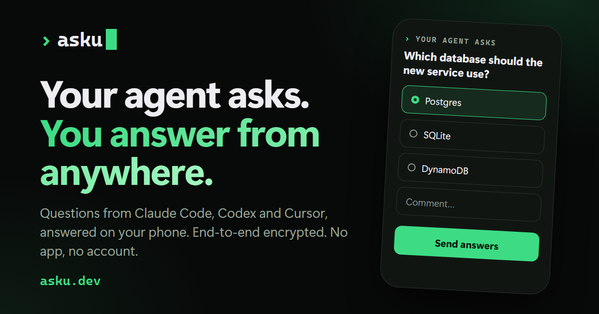

# asku

**Your AI agent asks. You answer from anywhere.** asku lets Claude Code, Codex, Cursor or any other agent send you a question form you answer on your phone; the agent gets JSON back and keeps working. End-to-end encrypted.

[](https://asku.dev)

## Quick start

Say this to your agent:

```
Install the skill at https://asku.dev/skill.md
```

It saves the skill and one script for your OS. Next time it needs a decision, it sends you a link. Or start from [asku.dev/start](https://asku.dev/start) and paste the link it gives you into your chat.

## Why

- **No app, no account.** The form is a web page; open the link on any phone, tablet or browser.
- **End-to-end encrypted.** Keys are made on the agent's machine and in your browser. The relay only stores ciphertext, and deletes it when the session ends.
- **Nothing to run on the agent side** beyond one script: `ask.sh` (bash, curl, OpenSSL) or `ask.ps1` (PowerShell). No MCP server, no daemon.
- **Any agent** that can run shell commands: Claude Code, Codex, Cursor, Gemini CLI.
- **Rich answers.** Yes/no, pick one, pick several, text, numbers and dates, with markdown context and a comment box on every question.
- **Open source** (MIT), small enough to audit, and you can [run your own relay](#deploy).

## Protocol

**Reviewing for privacy?** The code that touches keys or plaintext is [`shared/crypto.ts`](shared/crypto.ts), [`ui/session/`](ui/session) (key storage, binding, encrypt/decrypt) and the agent clients [`skill/ask.sh`](skill/ask.sh) / [`skill/ask.ps1`](skill/ask.ps1). The relay ([`api/`](api)) only stores ciphertext; the rest of [`ui/`](ui) is UI and never sees keys. Conventions: [`docs/coding-standards.md`](docs/coding-standards.md).

### Hard requirements
- Agent side: no installs beyond what the OS usually ships, no daemon. `ask.sh` needs bash, curl, OpenSSL ≥ 1.1.1 and coreutils; `ask.ps1` needs only PowerShell 5.1 + .NET Framework.
- Any AI agent, not Claude-specific. Distributed as a skill: `SKILL.md` + scripts, also served at `https://asku.dev/skill.md`.
- Public hosted relay: user moves between networks, uses phone/tablet, Windows + Linux agents.
- Relay never sees plaintext.

### Stack
- Relay: `Bun.serve` + `bun:sqlite`, single instance, zero runtime deps. Serves the static frontend too.
- Frontend: Bun-bundled static assets, hashed + SRI, strict CSP, no runtime CDN. Browser deps OK.
- Domain: asku.dev. Repo: public, MIT.

### Transport
- Agent: HTTP long-poll, server holds ≤25s (Bun `idleTimeout: 60`). Script loops internally and exits with `PENDING` (exit 2) before ~540s to stay under the agent tool timeout. Agent re-calls.
- Browser: SSE for incoming questions, POST for answers.
- Polling is idempotent via `?after=<seq>`.

### Trust flow
1. Agent: P-256 keypair A, token T = 16 random bytes.
2. Agent: `POST /s {pubA}` → `{sid}`.
3. Agent prints `https://asku.dev/a/<sid>#<sha256(pubA)>.<T>`. The fragment never reaches the server.
4. Browser: fetch pubA, verify its hash against the fragment.
5. Browser: keypair B, `POST {pubB, HMAC(T, pubB)}`. Single-use: the relay rejects a second binding.
6. Agent: poll, verify HMAC, derive keys.
7. Loop: encrypted q (seq n) ⇄ encrypted a (seq n). Agent sends an explicit `close`.
- Browser clears the fragment after reading it: `history.replaceState`.

#### Reverse: the user starts on the website
1. Browser: keypair B, T. `POST /s {pubB, role: "browser"}` → `{sid, key}`.
2. Browser shows the agent link `https://asku.dev/j/<sid>#<sha256(pubB)>.<T>`; the user pastes it to the agent.
3. Agent (`ask.sh join <link>`): fetch pubB, verify its hash, keypair A, `POST /s/:sid/bind {pubA, HMAC(T, pubA)}`.
4. Browser: long-polls `GET /s/:sid/bind`, verifies the HMAC, derives keys and sends the user's opening note as answer 0: `{ "note": "…" }`.
5. From here it is the normal loop: the agent asks, the browser answers.
- The joiner always gets the other role's write key, so only the agent can ask and close, and only the browser can answer.
- The agent link carries T through the agent's chat, as the forward link does through its output. T only gates the single binding.

### Crypto (chosen so openssl CLI, .NET Framework and WebCrypto all support it natively)
```
Z    = ECDH P-256
K    = SHA256(Z)                      # matches .NET ECDiffieHellmanCng.DeriveKeyMaterial default
kEnc = HMAC-SHA256(K, "enc"), kMac = HMAC-SHA256(K, "mac")
IV   = random 16 bytes per message
CT   = AES-256-CBC(kEnc, IV, PKCS7(pt))
TAG  = HMAC-SHA256(kMac, "v1|" + sid + "|" + dir + "|" + seq + "|" + IV + CT)
Verify TAG in constant time BEFORE decrypt.
```
- Public keys on the wire: raw uncompressed point, 65 bytes, base64. openssl converts by prepending the fixed P-256 SPKI header `3059301306072a8648ce3d020106082a8648ce3d030107034200`.
- UTF-8 everywhere. Standard base64, newlines stripped.
- `seq` in the tag is decimal ASCII; `IV + CT` are raw bytes appended to the ASCII header.
- `dir`: `q` agent to browser (questions and `say`), `a` the browser's answers, `m` the user's messages to the agent. `q` and `m` each count up from 1.
- Receivers compute the tag from the `dir` and `seq` they expect, never from the envelope, so replayed or reflected envelopes fail.
- Fragment: `hex(sha256(creator_pub_raw65)) + "." + hex(T)`. Binding: `base64(HMAC-SHA256(key=T, msg=joiner_pub_raw65))`. The vectors cover both directions.
- [`test/vectors.json`](test/vectors.json) with fixed keys and IVs, generated by `node:crypto` (`bun run vectors`). [`shared/crypto.ts`](shared/crypto.ts) (WebCrypto), [`skill/ask.sh`](skill/ask.sh) (openssl) and [`skill/ask.ps1`](skill/ask.ps1) (.NET Framework) must all match: `bun test`. CI on ubuntu + windows + macOS runners.
- `ask.sh` needs OpenSSL ≥ 1.1.1; macOS's bundled LibreSSL won't do (`brew install openssl@3`).

### Envelope (relay stores opaque)
`{ "v":1, "seq":n, "dir":"q"|"a"|"m", "iv":"…", "ct":"…", "tag":"…" }`

### v1 controls
`confirm`, `single`, `multi`, `review`, `rank`, `text`, `number` (stepper or slider), `date`, plus markdown context (DOMPurify) and an implicit per-question comment field.
Any question can carry `when: { "id": …, "is": … }` to show only for one answer to an earlier question in its batch (`is` means "contains" for `multi`); hidden ones go in `skipped`.
Answer shape: `{ "answers": { "<id>": value }, "skipped": [], "comments": { "<id>": "" }, "note": "" }`.
Unanswered optional questions go in `skipped`. Questions the user hands back with "Let the agent decide" go in `delegated`. If a question fails schema validation in the browser, the agent gets back `{ …, "error": "invalid question: …" }` instead.
- `deadline` (seconds) on a form: the page counts down and locks the batch at zero. The client stops waiting then and prints `{ "seqs": […], "answers": {}, "skipped": [<its ids>], …, "timeout": true }`. When the client queues the batch it adds `sent` (unix seconds), so the page counts from when the agent asked, not from when the page opened. Queue numbers can have gaps after a timeout; the client numbers messages on the wire from the last one it sent.
- `mood` on a form changes how the page looks (`confident`, `excited`, `nervous`, `begging`, `grumpy`, `sheepish`).
- A `say` message `{ "say": "<markdown>" }` is a one-way update shown in the page's feed. It takes a question seq but is never answered. With `"progress": { "done": n, "total": m }` (`0 <= n <= m`, `m >= 1`) it is a progress bar labelled by `say`; a later one with the same `say` moves that bar.
- The other way, the user can write to the agent at any time from the page, `{ "message": "…" }`, or press STOP, `{ "stop": true }` (`dir` `m`, shown in the feed too). The client prints each on the agent's next `ask`, `add`, `say` or `wait`, once.
- When a new question arrives, the page vibrates (where the browser supports it) and can beep if the user turns on the bell.
Plaintext shapes are defined in [`schema.json`](schema.json).

### Frontend
[`ui/`](ui): `bun run build` writes `dist/` (hashed assets with SRI; the schema validator is compiled at build time because the CSP forbids eval). The relay serves the site's pages (`/`, `/how`, `/security`, `/demo`, `/install`, `/start`, `/terms`, each with its own head and static copy from [`ui/site/pages.ts`](ui/site/pages.ts)), `/a/:sid` (answer) and `/j/:sid` (tells a human that link is for the agent, `noindex`) from it, the files in [`ui/static/`](ui/static) (icons, share image, `robots.txt`, `sitemap.xml`), plus the skill: `/skill.md` ([`skill/SKILL.md`](skill/SKILL.md)), `/ask.sh`, `/ask.ps1` and `/schema.json`.
The page keeps key pair B (non-extractable) and its write key in IndexedDB, so a reload or a closed tab carries on. The relay rejects a second binding, so the session stays tied to the first browser that opened it.

### Agent CLI
`skill/ask.sh` and `skill/ask.ps1` take the same commands:
```
ask.sh ask <questions.json | ->   # ask.ps1 ask <questions.json>
ask.sh add <questions.json | ->   # append to the open form without waiting
ask.sh join <agent link>          # session the user started on the website; prints {"note": …}
ask.sh say <text>                 # one-way update on the page; queued until the user opens the link
ask.sh say <label> --progress 42/50  # a progress bar; the same label moves the same bar
ask.sh wait
ask.sh close
ask.sh version                    # client version, same in both scripts
```
- Exit `0`: the answer JSON is on stdout. Exit `2`: `PENDING` on stdout; show the user any link it prints, then run `wait`. Exit `1`: error on stderr. Exit `3`: the user pressed STOP.
- The user's messages print first, one JSON line each (`{"message": …}` or `{"stop": true}`), ahead of the usual output. A message ends a `wait` early, as `PENDING`. The client keeps the last one it printed in `m`; clients before 1.4.0 never ask the relay for messages.
- The first `ask` creates the session and returns `PENDING` right away with the link, so the agent can hand it to the user.
- One question message per round: the next `ask` is refused until the last one is answered.
- If the binding fails the token check, the session is deleted and the command exits `1`.
- `join` refuses a link whose hash doesn't match the session's key, and a session name already in use. A joined session talks to the relay in its link, whatever `ASKU_URL` says.
- State lives in `~/.asku/<session>/` (`ask.sh` creates it mode 700). The agent private key never leaves it.
- Env: `ASKU_URL` (default `https://asku.dev`), `ASKU_SESSION` (default `default`), `ASKU_HOME`, `ASKU_WAIT` (seconds before `PENDING`, default 500).

### Relay API
[`api/relay.ts`](api/relay.ts). `bun run dev` builds and runs it on :8080, rebuilding and live-reloading on changes; `bun api/relay.ts` alone (env: `PORT`, `ASKU_DB`, `ASKU_HOST`, `ASKU_IP_HEADER`, `ASKU_VAPID_*` for push notifications).
Trust `ASKU_IP_HEADER` only when nothing but the proxy can reach the port, or anyone can forge it and dodge the rate limit.

#### Deploy
[`compose.yaml`](compose.yaml) runs the relay and `cloudflared` side by side with no published ports, so `cf-connecting-ip` can be trusted. The tunnel is remotely managed: its ingress (`asku.dev → http://relay:8080`) and the proxied `asku.dev` CNAME live in Cloudflare.
```
# copy compose.yaml to the host's stack dir, then:
echo "TUNNEL_TOKEN=…" > .env    # cf tunnels token get <tunnel id>
docker compose up -d            # pulls ghcr.io/maca134/asku:latest; --build builds from a checkout instead
```
Releases deploy themselves: publishing a GitHub Release runs the tests and pushes `ghcr.io/maca134/asku:<version>` and `:latest` ([release.yml](.github/workflows/release.yml)), and the host's Watchtower (label-enable, logged in to ghcr.io, hourly) pulls `:latest`. Roll back with `image: ghcr.io/maca134/asku:<older version>`.
POST bodies must be `application/json`. Writes take `Authorization: Bearer <key>`; reads only need the sid.

"Creator" and "joiner" are the agent and browser in the usual flow, swapped in the reverse flow.

| Who | Request | Response |
|---|---|---|
| creator | `POST /s {pub, role?}` | `201 {sid, key}`: `role` is `agent` (default) or `browser`; `key` is the creator's write key |
| joiner | `GET /s/:sid` | `{pub, role, bound}`: the creator's pub and role |
| joiner | `POST /s/:sid/bind {pub, mac}` | `201 {key}`: the write key for the other role. `409` if already bound |
| creator | `GET /s/:sid/bind` | long-poll: `{pub, mac}` once bound, else `204` after 25s |
| agent | `POST /s/:sid/q` envelope, agent key | `204`; `seq` must be last q + 1, else `409` |
| agent | `GET /s/:sid/a?after=n&m=k` | long-poll: `[envelope…]`, answers with seq > n and, with `m`, messages with seq > k; else `204` after 25s |
| agent | `GET /s/:sid/m?after=k` | `[envelope…]`, the messages with seq > k, at once (maybe `[]`) |
| agent | `DELETE /s/:sid`, agent key | `204`, session purged |
| browser | `GET /s/:sid/q?after=n` | SSE: `event: q` with `id: seq`, data = envelope; `event: close` on purge. Resumes from `Last-Event-ID` |
| browser | `POST /s/:sid/a` envelope, browser key | `204`; `seq` must match an asked q not yet answered, or be `0` (once) in a browser-created session, else `409` |
| browser | `POST /s/:sid/m` envelope, browser key | `204`; `seq` must be last m + 1, else `409` |
| browser | `PUT /s/:sid/push` a `PushSubscription`, browser key | `204`: each new q sends a Web Push to it. `404` when push is off |
| browser | `DELETE /s/:sid/push`, browser key | `204`, no more pushes for this session |

Errors are `{error}` with `400 401 404 405 409 413 429`. The relay stores only sha256 of write keys.

#### Push notifications
The answer page's phone button asks for a notification on that device when the agent posts to that session; nothing is asked until it's tapped, and a second tap turns it off. The site installs as an app (`/manifest.webmanifest`, service worker `/sw.js`). Works in Chrome on Android and desktop browsers; on iOS (16.4+) only after "Add to Home Screen", with the session opened from the installed app.
- The push ([`api/push.ts`](api/push.ts), sent with [`web-push`](https://github.com/web-push-libs/web-push)) carries only `{sid, seq}`. The service worker looks up the session's name in IndexedDB and shows "New questions in <name>", unless that session's page is open and visible.
- When the batch is a single `confirm` question (and the agent isn't `nervous`), the service worker fetches it from the question feed, decrypts it with the session's stored keys, and adds the question and Yes/No buttons to the notification. A button seals and sends the same answer the page would; an open page marks it answered. Without notification actions (iOS) a tap opens the page. The question text then shows in the device's notification, never at the relay.
- `GET /s/:sid` adds `push` (the VAPID public key) when push is on. Endpoints must be a known push service (FCM, Mozilla, Windows, Apple). The subscription is stored with the session and goes when it's closed or expires, or when the push service says it's gone.
- Off unless `ASKU_VAPID_PUBLIC`, `ASKU_VAPID_PRIVATE` and `ASKU_VAPID_SUBJECT` (`mailto:` or `https:` contact) are all set. `bun api/push.ts` prints a new key pair.


### Relay hygiene
- Payload cap 256 KB, 8 MB and 1000 questions per session. Per-IP rate limit on session creation (20 / 10 min).
- Purge on `close`. 24h idle TTL as fallback.
- Headers: CSP `default-src 'none'; script-src 'self'; style-src 'self'; img-src 'self' data: blob:; connect-src 'self'; manifest-src 'self'; frame-ancestors 'none'; base-uri 'none'; form-action 'none'` and `Referrer-Policy: no-referrer`.
